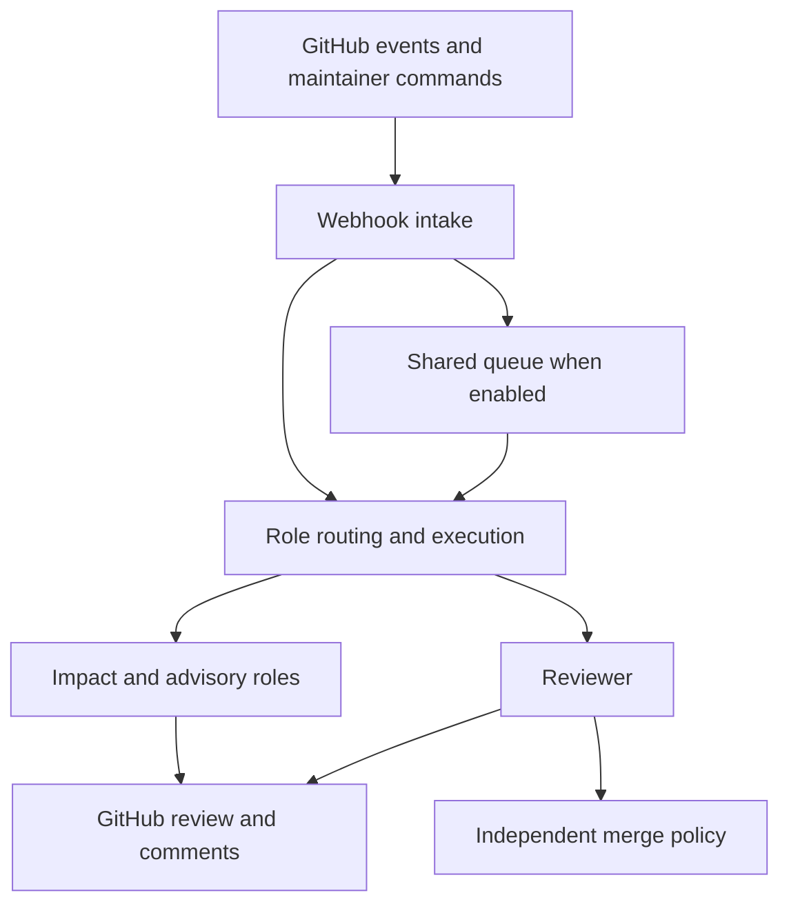

# Oddmash Agents

Advisory agents for Oddmash products. The first agent, Reviewer, helps maintainers identify concrete regressions in pull requests while preserving project-specific conventions and maintainer control.

## Agent family

| | Agent | Responsibility | Execution | Command |
| --- | --- | --- | --- | --- |
|  | Oddmash Reviewer | Code quality, defects and accessibility | Automatic | `/review` |
|  | Oddmash Impact | Product value, necessity and trade-offs | On request | `/impact` |
|  | Oddmash Triage | Issue classification, duplicates and priority | On request | `/triage` |
|  | Oddmash QA | Missing tests and observed verification | On request | `/qa` |
|  | Oddmash Release | Changelog and release note drafts | On request | `/release` |
|  | Oddmash Docs | Code and documentation consistency | On request | `/docs` |
|  | Oddmash Architect | Design and maintainability assessment | On request | `/architect` |

Reviewer is the only automatic agent. The other roles run on explicit maintainer mentions and produce advisory output. They share the same server and queue, while role-specific identity, permissions and model usage remain separately configurable. Dedicated apps must be configured before their own mentions become available; the Reviewer mention is the compatibility entry point.

See [agent family and setup](docs/agent-family.md) for invocation details and role configuration.

## Reviewer

- Analyzes open PRs in public and explicitly approved private repositories using GitHub's changed-file and check APIs.
- Uses organization and trusted base-branch root and nested `AGENTS.md` guidance.
- Produces English, evidence-linked, severity-ranked reports and optional inline GitHub Suggested changes; posting is explicitly enabled and deduplicated per finding and commit. Private reviews keep stricter data exclusions, use repository-scoped authentication, and remain subject to separate merge eligibility.
- Never checks out or executes contributor code or modifies source. The advisory reviewer never merges. An independently gated maintainer-only merge module can merge eligible low-risk changes after issue verification, current CI and review approval.

Oddmash operates a maintainer-configured organization GitHub App that can approve fully reviewed changes with passing checks or request changes for high-confidence findings. Independent deployments remain report-only until explicitly configured. Private repository enrollment requires separate maintainer approval, and approved private repositories can use the same separately gated merge policy for eligible low-risk changes.

See [CONTRIBUTING.md](CONTRIBUTING.md) for setup and [the rollout plan](docs/rollout.md) for the activation checklist.

## Architecture

Use a single modular serverless application, shared queue and independently configured agent roles. Keep advisory execution separate from approval and merge policy. Shared skills provide guidance, not execution permissions.

The local CLI and organization workflow also use the review engine. Queue-backed execution is optional; neither path replaces repository checks or release policy.

| Component | Responsibility |
| --- | --- |
| [Webhook intake](api/github.ts) and [queue worker](api/review-jobs.ts) | Receive eligible events and coordinate review jobs. |
| [Review orchestration](src/webhook-review.ts) | Coordinate evidence, progress and publication. |
| [Review engine](src/reviewer.ts) and [review model](src/core.ts) | Collect bounded evidence, validate findings and classify outcomes. |
| [Product context](src/review-context.ts) and [CI evidence](src/checks.ts) | Supply project-specific quality criteria and current check results. |
| [Discussion](src/review-discussion.ts), [Impact](src/impact.ts) and [advisory engine](src/advisory.ts) | Support evidence-based follow-up and on-demand role assessments. |
| [Merge policy](src/auto-merge.ts) | Independently verify eligibility before any authorized merge. |
| [Evaluation](src/evaluation.ts) and [offline tests](tests/) | Measure finding accuracy and protect behavior with deterministic fixtures. |

### Evolution

Prioritize a small shared execution contract and model adapter ([#63](https://github.com/Oddmash/oddmash-agents/issues/63)), minimal role-aware execution history ([#62](https://github.com/Oddmash/oddmash-agents/issues/62)), and bounded usage with cost monitoring ([#64](https://github.com/Oddmash/oddmash-agents/issues/64)). Start with existing infrastructure and deterministic tests.

Defer a dedicated dashboard until logs prove insufficient. Keep cross-agent collaboration explicit and maintainer-directed. Split servers or queues only when measured load, reliability or isolation needs justify the operational cost.

### Development and release

Implement changes on focused branches targeting `develop`. Integrate after CI and review, then consolidate tested changes into a release PR to `main`. Production releases are separate from advisory review. Guarded auto-merge may target `develop` or the default `main` branch only when the existing repository, maintainer, acceptance, low-risk, exact-head CI and branch-protection requirements are satisfied. Incomplete review coverage does not constitute approval.

See [review quality](docs/review-quality.md), [evaluation baseline](docs/evaluation-baseline.md) and [rollout](docs/rollout.md) for operational details.

## Shared guidance

[Oddmash Skills](https://github.com/Oddmash/oddmash-skills) owns reusable work methods. This repository owns executable agents and operational controls. See the [skill integration contract](docs/skill-integration.md) for the approved reference, upgrade procedure, and boundaries.
