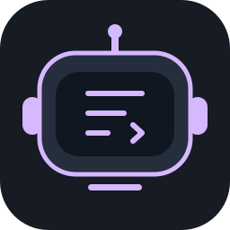
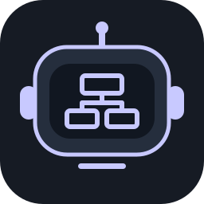
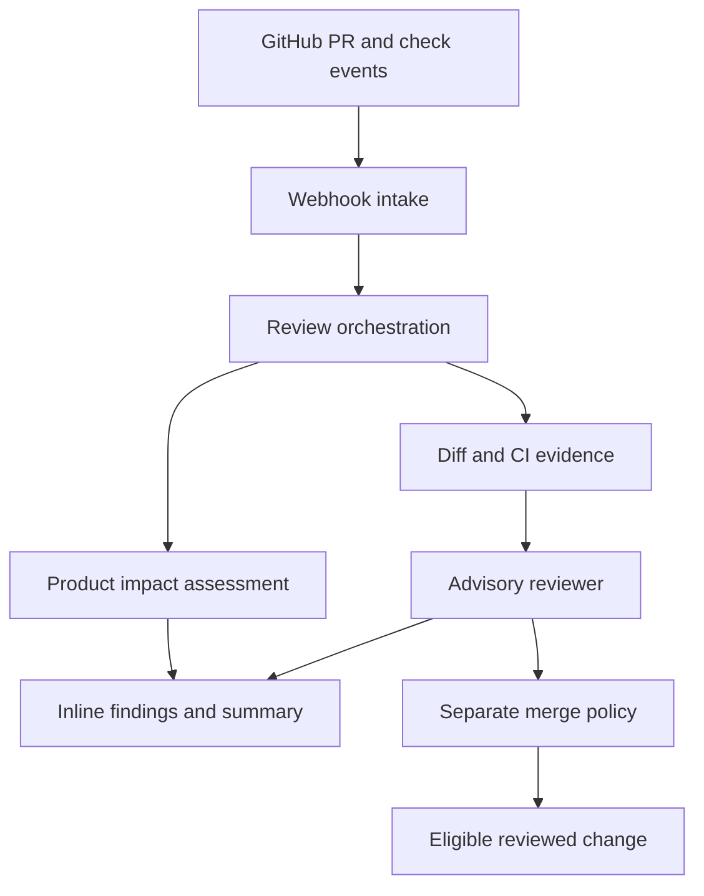

# Oddmash Agents

Advisory agents for Oddmash products. The first agent, Reviewer, helps maintainers identify concrete regressions in pull requests while preserving project-specific conventions and maintainer control.

## Agent family

| | Agent | Responsibility | Execution | Command |
| --- | --- | --- | --- | --- |
|  | Oddmash Reviewer | Code quality, defects and accessibility | Automatic | `/review` |
|  | Oddmash Impact | Product value, necessity and trade-offs | On request | `/impact` |
|  | Oddmash Triage | Issue classification, duplicates and priority | On request | `/triage` |
|  | Oddmash QA | Missing tests and observed verification | On request | `/qa` |
|  | Oddmash Release | Changelog and release note drafts | On request | `/release` |
|  | Oddmash Docs | Code and documentation consistency | On request | `/docs` |
|  | Oddmash Architect | Design and maintainability assessment | On request | `/architect` |

Reviewer is the only automatic agent. The other roles run on explicit maintainer mentions and produce advisory output. They share the same server and queue, while role-specific identity, permissions and model usage remain separately configurable. Dedicated apps must be configured before their own mentions become available; the Reviewer mention is the compatibility entry point.

See [agent family and setup](docs/agent-family.md) for invocation details and role configuration.

## Reviewer

- Analyzes open PRs in public and explicitly approved private repositories using GitHub's changed-file and check APIs.
- Uses organization and trusted base-branch root and nested `AGENTS.md` guidance.
- Produces English, evidence-linked, severity-ranked reports and optional inline GitHub Suggested changes; posting is explicitly enabled and deduplicated per finding and commit. Private reviews keep stricter data exclusions, use repository-scoped authentication, and remain subject to separate merge eligibility.
- Never checks out or executes contributor code or modifies source. The advisory reviewer never merges. An independently gated maintainer-only merge module can merge eligible low-risk changes after issue verification, current CI and review approval.

Oddmash operates a maintainer-configured organization GitHub App that can approve fully reviewed changes with passing checks or request changes for high-confidence findings. Independent deployments remain report-only until explicitly configured. Private repository enrollment requires separate maintainer approval, and approved private repositories can use the same separately gated merge policy for eligible low-risk changes.

See [CONTRIBUTING.md](CONTRIBUTING.md) for setup and [the rollout plan](docs/rollout.md) for the activation checklist.

## Architecture

The runtime separates event intake, evidence collection, advisory decisions and release authorization. Shared skills provide guidance, not execution permissions.

Queue-backed delivery is available for configured deployments. The local CLI and organization workflow also use the review engine; neither replaces repository checks or release policy.

| Component | Responsibility |
| --- | --- |
| [Webhook intake](api/github.ts) and [queue worker](api/review-jobs.ts) | Receive eligible events and coordinate review jobs. |
| [Review orchestration](src/webhook-review.ts) | Coordinate evidence, progress and publication. |
| [Review engine](src/reviewer.ts) and [review model](src/core.ts) | Collect bounded evidence, validate findings and classify outcomes. |
| [Product context](src/review-context.ts) and [CI evidence](src/checks.ts) | Supply project-specific quality criteria and current check results. |
| [Discussion](src/review-discussion.ts) and [impact assessment](src/impact.ts) | Support evidence-based follow-up and product decisions. |
| [Merge policy](src/auto-merge.ts) | Independently verify eligibility before any authorized merge. |
| [Evaluation](src/evaluation.ts) and [offline tests](tests/) | Measure finding accuracy and protect behavior with deterministic fixtures. |

### Development and release

Implement changes on focused branches targeting `develop`. Integrate after CI and review, then consolidate tested changes into a release PR to `main`. Production releases are separate from advisory review.

See [review quality](docs/review-quality.md), [evaluation baseline](docs/evaluation-baseline.md) and [rollout](docs/rollout.md) for operational details.

## Shared guidance

[Oddmash Skills](https://github.com/Oddmash/oddmash-skills) owns reusable work methods. This repository owns executable agents and operational controls. See the [skill integration contract](docs/skill-integration.md) for the approved reference, upgrade procedure, and boundaries.
